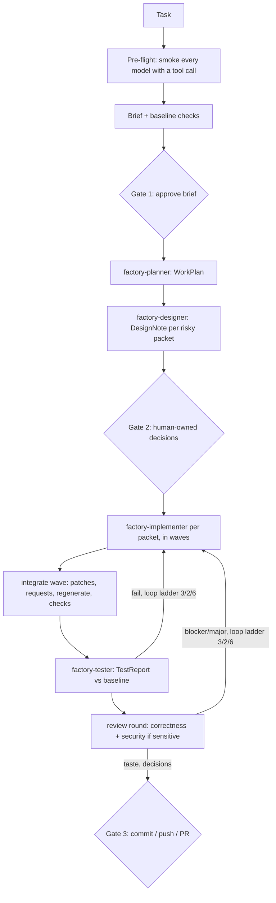

# omp-factory

A software factory for [oh-my-pi](https://github.com/can1357/oh-my-pi): a main-session coordinator takes a high-level task through brief → plan → design → implement → test → review → integrate, with specialist subagents exchanging schema-validated handoffs. Architecture and taste decisions go to you.



Fix-loop ladder (`3/2/6`): loops 1–3 autonomous, logged in the run; loops 4–5 coordinator-approved with decision-ledger evidence of a novel defect and phase-appropriate progress; 6th attempt asks the user. Thrash (a recurring finding or no progress) escalates immediately at any count.

## Why the coordinator is a skill

Subagents run headless and cannot ask you anything. Only the main session can raise a question, so the coordinator lives there as the `factory` skill. Workers report `decisions[]`, and the coordinator batches them into one form per gate.

## Principles

- **The human owns architecture and taste.** Every decision has a `kind`. Only non-blocking `implementation` decisions are auto-adopted; `architecture`, `public_api`, `dependency`, `data`, `security` and `style` always reach a gate, with the recommendation preselected. Existing code is precedent, not taste: following it raises nothing.
- **Reviewers never re-litigate.** They receive the decision ledger. Disagreement with a decided choice becomes a new decision, not a finding. `taste` findings are always `nit` and go to Gate 3, never into the fix loop.
- **Models are proven before work starts.** Pre-flight spawns each distinct model once and requires a schema-valid `yield` (a real tool call) before the baseline runs; the reviewers must be a different model family from the implementer. A failing model stops the run with the raw error, and role switches are session-only unless you choose to save them.
- **Verdicts are relative to a baseline.** Checks run on the base commit first; pre-existing failures are not the run's failures.
- **Nothing is committed before Gate 3.** The tree is frozen (`factory-state.sh freeze`) before test and review, and every report must match the freeze. The only exception: large tasks commit locally once per milestone, so each milestone has a diff base and a rollback point.

## File ownership

| Level | Meaning | Parallel safety |
|---|---|---|
| `owns` | Only this packet edits it | Exclusive across all packets |
| `shares` | Several packets change logic in it | With isolation, each packet's patch lands in turn and conflicts go to `factory-integrator`; without isolation, sharers are serialized |
| `requests` | Only an entry in a registry file (exports, routes, dependency lists) | The coordinator applies entries after the wave |

Generated files (lockfiles, codegen) belong to no packet; the coordinator regenerates them. Shared types and signatures go in a wave-0 `contract` packet that others depend on. Large tasks run as **milestones**, each a full plan → review cycle with a gate where you can re-plan the rest.

## Layout

| Path | Purpose |
|---|---|
| `agents/factory-*.md` | Seven specialist agents. Each has an `output:` JSON Schema, which is the handoff contract, and a `Verification criteria` section it self-checks before `yield`. |
| `skills/factory/SKILL.md` | Coordinator playbook: triage, baseline, gates, waves, fix loops, review rounds, milestones, integration, with a verification check after each phase |
| `skills/factory/templates/` | Brief, decision ledger, run state, per-repo `RULES.md` |
| `skills/factory/scripts/factory-state.sh` | Coordinator state helper: freeze record + sha (`freeze`), tree==freeze check (`verify`), persisted fix-loop count and ladder tier (`loops test|review|security`) |
| `hooks/pre/factory-guard.ts` | Blocks subagents from git history, branch, checkout/restore/reset and GitHub mutations; only the coordinator integrates |
| `config/config.example.yml` | Optional model roles and isolation settings |
| `.omp/RULES.md` | Repo rules read by every agent, including subagents; Test: `bun test` |

## Prerequisites

- [oh-my-pi](https://github.com/can1357/oh-my-pi) (`omp`) installed and configured with at least one model provider.
- `git`. The coordinator creates a `factory/<slug>` branch in the target repo and refuses to start on a dirty working tree.
- Models resolve from your OMP model roles: planner, designer, implementer, integrator and tester fall back to `@default`; both reviewers to `@advisor` (a different family on purpose). Optional `@factory_plan/impl/test/review` roles override a phase without code changes (see `config/config.example.yml`).
- For parallel isolated packets: `task.isolation.enabled: true`, `merge: patch`, `apply: true`. Otherwise packets share one checkout and sharers are serialized.
- [Bun](https://bun.sh), only for running this repo's tests.

## Install

```bash
./install.sh
```

The script symlinks the agents, the skill and the hook into `~/.omp/agent/`, which makes them available in every repo. Edits in this repo take effect in new sessions and in agents spawned mid-run. To run the factory while editing it, install from a separate worktree: `git worktree add ../omp-factory-stable main && ../omp-factory-stable/install.sh`. The script is safe to re-run, and it never overwrites a real file.

Optionally, merge `config/config.example.yml` into `~/.omp/agent/config.yml`.

## Per-repo setup

Subagents receive `.omp/RULES.md` but not `AGENTS.md`. Each repo therefore needs a short `.omp/RULES.md` that lists its build, test and lint commands and its generated files (see `skills/factory/templates/RULES.md`). If the file is missing, the coordinator drafts one and shows it to you at Gate 1. This repo dogfoods its own `.omp/RULES.md` at the root.

To specialize a role for one repo, add `.omp/agents/factory-tester.md` (or another role) to that repo. Project agents override user agents of the same name.

## Use

```
/skill:factory Add rate limiting to the public API
```

Each run's artifacts go in `.factory/runs/<slug>/` inside the target repo. The coordinator adds `.factory/` to `.git/info/exclude`, so the run directory stays untracked without editing `.gitignore`. Watch and steer workers live from Agent Hub (`Alt+A`).

## Gates

| Gate | When | You decide |
|---|---|---|
| 1 | Always, before planning | Brief, acceptance criteria, milestone outline (large), drafted `RULES.md`, non-green baseline |
| 2 | Any blocking decision, or any decision not of kind `implementation` | Architecture, API, dependency, data, security and style choices; the packet table when architecture or contracts are involved |
| Milestone | After each milestone (large) | Continue, re-plan the rest, or stop |
| 3 | Always, before anything is committed | Taste findings to apply, reviewer decisions, commit, push, PR, or leave uncommitted |

## Guard hook limits

`factory-guard.ts` is an approval guard, not a sandbox. It applies only to subagents (`ctx.agent.kind === "sub"`); the main session (the coordinator) is unaffected.

- It inspects `bash` tool calls only. Commands run through `eval` (for example a Python `subprocess` call) are not seen.
- It matches command text with regular expressions and does not parse shell syntax. Aliases, variables, wrapper scripts and unusual flag orders can slip past it.
- It does not restrict which files a subagent edits. The coordinator enforces packet file ownership by checking `git status` after each wave.

## Tests

```bash
bun test
```

Without a standalone Bun, omp's embedded one works: `BUN_BE_BUN=1 "$(realpath "$(which omp)")" test`. Tests cover the guard patterns, the state helper and recipes, and keep the copied `decisions[]` and ReviewReport schemas identical across agents (omp has no schema `$ref`).
