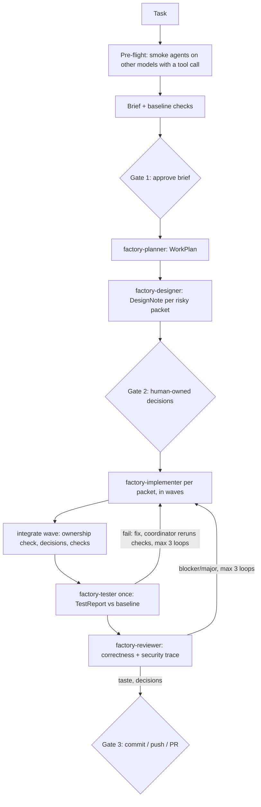

# omp-factory

A software factory for [oh-my-pi](https://github.com/can1357/oh-my-pi): a main-session coordinator takes a high-level task through brief → plan → design → implement → test → review → integrate, with specialist subagents exchanging schema-validated handoffs. Architecture and taste decisions go to you.



Fix loops: 1–3 run autonomously; a 4th asks you. Thrash (a recurring finding or no progress) asks you at any count. Only the first test pass spawns the tester; after a fix the coordinator reruns the Test command and the failed checks itself.

## Why the coordinator is a skill

Subagents run headless and cannot ask you anything. Only the main session can raise a question, so the coordinator lives there as the `factory` skill. Workers report `decisions[]`, and the coordinator batches them into one form per gate.

## Principles

- **The human owns architecture and taste.** Every decision has a `kind`. Non-blocking `implementation` decisions, and choices already settled (by the Brief, precedent, or your stated direction) or whose options look the same to users and operators, are auto-adopted and listed at the gate for override. Every other `architecture`, `public_api`, `dependency`, `data`, `security` and `style` choice reaches a gate as a question, with the recommendation preselected. Existing code is precedent, not taste: following it raises nothing.
- **Questions are written for someone outside the code.** Each gate question says, in plain words, which part of the system it concerns, what happens today, why it is being asked, and the consequences of each option, with the recommendation labeled. Ids and `path:line` evidence stay in the ledger. Workers supply that material in `decisions[]`; the coordinator writes the final text.
- **Reviewers never re-litigate.** They receive the decision ledger. Disagreement with a decided choice becomes a new decision, not a finding. `taste` findings are always `nit` and go to Gate 3, never into the fix loop.
- **Models are proven before work starts.** Pre-flight smokes every agent whose model differs from the coordinator's; each must return a schema-valid `yield` (a real tool call) before the baseline runs. The reviewer must be a different model family from the implementer. A failing model stops the run with the raw error, and role switches are session-only unless you choose to save them.
- **Verdicts are relative to a baseline.** Checks run on the base commit first; pre-existing failures are not the run's failures.
- **Nothing is committed before Gate 3.** The tree is frozen (`factory-state.ts freeze`) before test and review, and every report must match the freeze.
- **The run dir is the state.** Workers are spawned from eval `agent()` and their parsed yields written straight to the run dir; `factory-state.ts status` derives the live generations, loop counts, and freeze state from it.

## File ownership

| Level | Meaning | Parallel safety |
|---|---|---|
| `owns` | Only this packet edits it | Exclusive across all packets |
| `shares` | Several packets change logic in it | Sharers in one wave are serialized |
| `requests` | Only an entry in a registry file (exports, routes, dependency lists) | The packet applies it and runs the regenerate command; requesters of one file in one wave are serialized |

Generated files (lockfiles, codegen) are never in `owns` or `shares`. Shared types and signatures go in a wave-0 `contract` packet that others depend on. `factory-state.ts validate` checks these rules; `waves` orders the packets. A task too large for one run goes to `factory-spec`, which splits it into several runs, each shippable on its own.

## Layout

| Path | Purpose |
|---|---|
| `agents/factory-*.md` | Five specialist agents. Each has an `output:` JSON Schema, which is the handoff contract, and a `Verification criteria` section it self-checks before `yield`. |
| `skills/factory/SKILL.md` | Coordinator playbook: triage, pre-flight, baseline, gates, waves, test, review rounds, fix ladder, integration |
| `skills/factory/templates/` | Brief, decision ledger, run state, per-repo `RULES.md` |
| `skills/factory/scripts/factory-state.ts` | Coordinator state helper: `freeze`, `verify` (tree == freeze), `snapshot`/`changed` (paths a wave touched), `coverage` (pre-review diff check), `loops test\|review` (fix-loop count and tier), `validate` (plan ownership and dependency checks), `waves` (wave order), `status` (live run state) |
| `skills/factory-retro/SKILL.md` | Retro playbook: root-cause a finished run's friction signals against the factory and propose additions and deletions in one form |
| `skills/factory-retro/scripts/factory-retro.ts` | Retro collector: `collect <run-dir>...` prints a run's friction signals (re-plans, schema failures, advisories, deviations, fix loops, decisions) as JSON; `report <run-dir>...` writes a static `report.html` per run (packet DAG, loops, decisions, Log) |
| `skills/factory-spec/SKILL.md` | Spec playbook: read the code first, interview in batched rounds, write `spec.md`, a decision ledger and a roadmap of factory-run Briefs, check, review, hand off |
| `skills/factory-spec/scripts/factory-spec.ts` | Spec check: `check <spec-dir>` verifies the three files, ledger entries, cited decision and run ids, and each run's Goal/Scope/Acceptance |
| `hooks/pre/factory-guard.ts` | Blocks subagents from git history, branch, checkout/restore/reset and GitHub mutations; only the coordinator integrates |
| `config/config.example.yml` | Optional model roles |
| `.omp/RULES.md` | Repo rules read by every agent, including subagents; Test: `bun test` |

## Prerequisites

- [oh-my-pi](https://github.com/can1357/oh-my-pi) (`omp`) installed and configured with at least one model provider.
- `git`. The coordinator creates a `factory/<slug>` branch in the target repo and refuses to start on a dirty working tree.
- Models resolve from your OMP model roles: planner, designer, implementer and tester fall back to `@default`; the reviewer to `@advisor` (a different family on purpose). Optional `@factory_plan/impl/test/review` roles override a phase without code changes (see `config/config.example.yml`).
- Recommended: the omp advisor (`omp://advisor-watchdog.md`). Its `<advisory>` notes are what the playbook calls advisories; across five real runs, 17 were adopted, several correcting a plan or design before implementation. Without it the factory runs unchanged and logs no advisories.
- No other runtime: the scripts and tests run on omp's bundled Bun (a standalone [Bun](https://bun.sh) also works).

## Install

```bash
./install.sh
```

The script symlinks the agents, the skills and the hook into `~/.omp/agent/`, which makes them available in every repo. Edits in this repo take effect in new sessions and in agents spawned mid-run. To run the factory while editing it, install from a separate worktree: `git worktree add ../omp-factory-stable main && ../omp-factory-stable/install.sh`. The script is safe to re-run, and it never overwrites a real file.

Optionally, merge `config/config.example.yml` into `~/.omp/agent/config.yml`.

## Per-repo setup

Each repo needs a short `.omp/RULES.md` that lists its build, test and lint commands and its generated files (see `skills/factory/templates/RULES.md`). If the file is missing, the coordinator drafts one and shows it to you at Gate 1. This repo dogfoods its own `.omp/RULES.md` at the root.

What omp subagents receive (smoke-tested on omp 18.22.2): `.omp/RULES.md`, and `.agents/rules/*.md` files with `alwaysApply: true` frontmatter. They do not receive `AGENTS.md`, `.agents/AGENTS.md`, or `.agents/RULES.md`, and `@path` imports inside a rule are not expanded. Repo commands must therefore live in one of the two files subagents receive.

To specialize a role for one repo, add `.omp/agents/factory-tester.md` (or another role) to that repo. Project agents override user agents of the same name.

## Use

```
/skill:factory-spec Migrate the order service from REST polling to webhooks
/skill:factory Add rate limiting to the public API
/skill:factory-retro <run-dir>...
```

Each run's artifacts go in `.factory/runs/<slug>/` inside the target repo. The coordinator adds `.factory/` to `.git/info/exclude`, so the run directory stays untracked without editing `.gitignore`. Watch and steer workers live from Agent Hub (`Alt+A`).

After a run, `/skill:factory-retro` turns one or more run directories into proposed changes to this factory or to the target repo's `.omp/RULES.md`. Nothing is edited until you accept a proposal.

For a change too large or vague for one run, start with `/skill:factory-spec`. It writes `docs/specs/<YYYYMMDD-slug>/` in the target repo (spec, decision ledger, roadmap), and each roadmap item becomes one `/skill:factory` run that imports the ledger's decisions as closed.

## Gates

| Gate | When | You decide |
|---|---|---|
| 1 | Always, before planning | Brief, acceptance criteria, human-owned open questions, drafted `RULES.md`, non-green baseline, missing git identity |
| 2 | Any blocking decision, or any decision not of kind `implementation` | Architecture, API, dependency, data, security and style choices; the packet table when architecture or contracts are involved |
| 3 | Always, before anything is committed | Taste findings and stale-doc fixes to apply, reviewer decisions, commit, push, PR, or leave uncommitted |

## Guard hook limits

`factory-guard.ts` is an approval guard, not a sandbox. It applies only to subagents (`ctx.agent.kind === "sub"`); the main session (the coordinator) is unaffected.

- It inspects `bash` tool calls only. Commands run through `eval` (for example a Python `subprocess` call) are not seen.
- It matches command text with regular expressions and does not parse shell syntax. Aliases, variables, wrapper scripts and unusual flag orders can slip past it.
- It does not restrict which files a subagent edits. The coordinator checks each wave's changed paths (`factory-state.ts changed`) against packet ownership.

## Tests

```bash
bun test
```

Without a standalone Bun, omp's embedded one works: `BUN_BE_BUN=1 "$(realpath "$(which omp)")" test`. Tests cover the guard patterns, the state helper, the retro collector and report, and keep the copied `decisions[]` schemas identical across agents (omp has no schema `$ref`).
